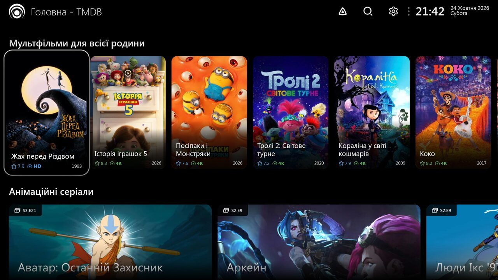
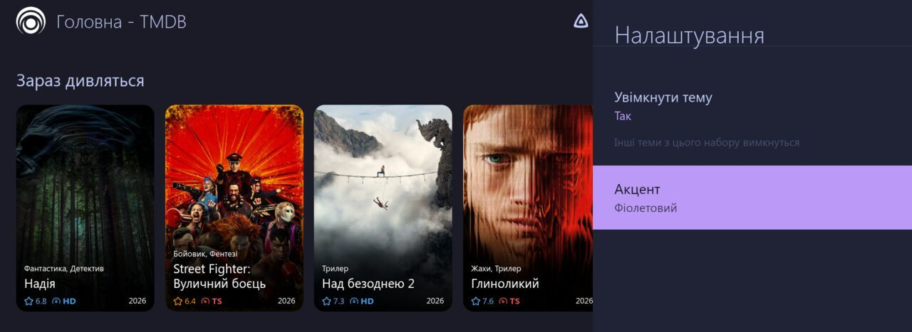
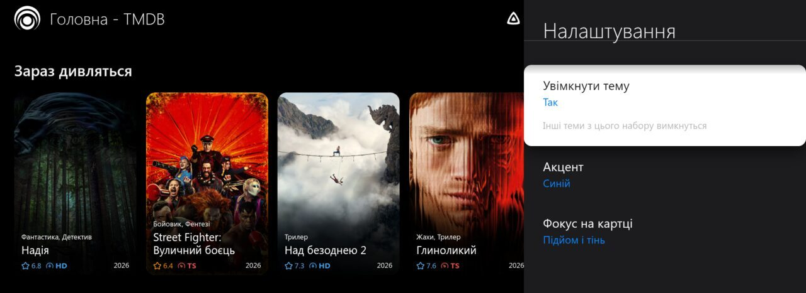
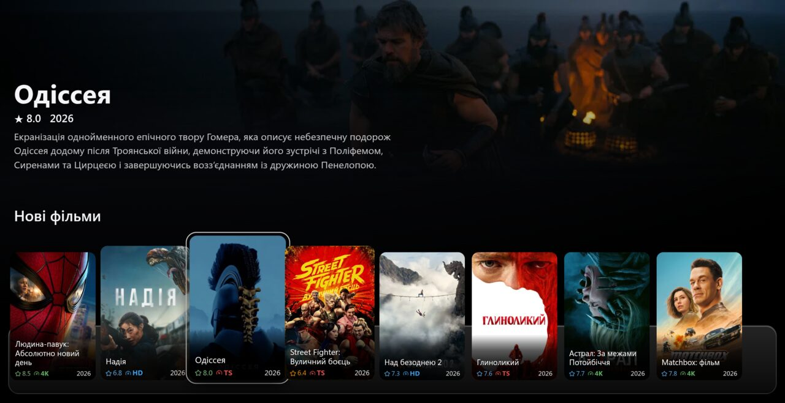
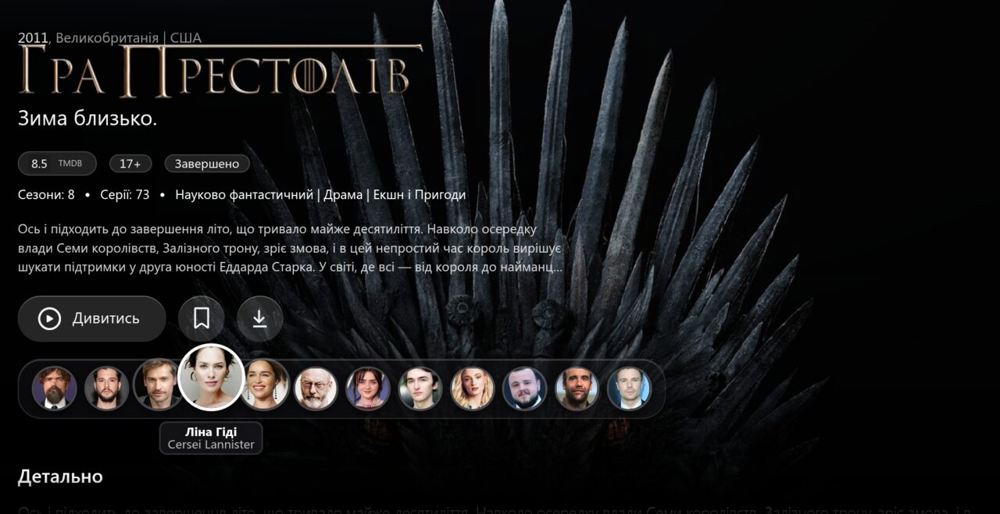
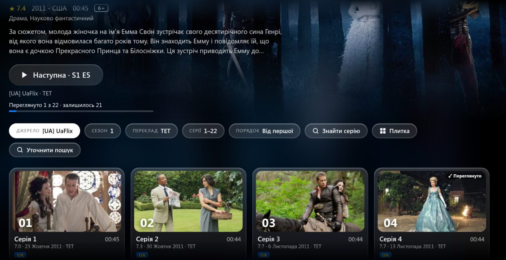
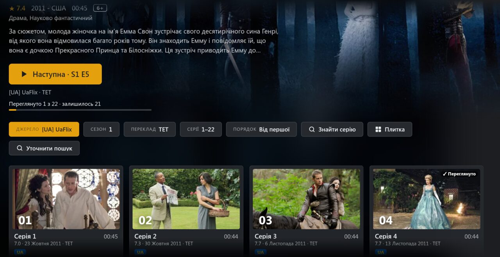

# Lampac Extra Modules (`EX.*`)

Додаткові онлайн-модулі для Lampac NextGen.
Усі модулі мають префікс `EX.` і власні адреси `lite/ex_*`, тож не конфліктують із вбудованими модулями Lampac.

## Навігація

- [Українська](#ua)
- [English](#en)

## <a id="ua"></a>Українська

### Доступні модулі

**Аніме**
- `EX.AnimeON` — AnimeON з точним вибором тайтлу за MAL ID
- `EX.Mikai` — Mikai з точним вибором тайтлу за назвою оригіналу
- `EX.MoonAnime` — MoonAnime через акаунт (потрібна підписка), відео без браузера

**Службові**
- `EX.TvCtl` + плагін `tvctl.js` + утиліта `tvctl` — пульт для Lampa: відкрити картку, джерело, серію з компʼютера і бачити, що відбувається (які запити пішли до джерел, з якою помилкою, чи стартував плеєр)
- `EX.Mcp` + плагін `lampac-mcp.js` — [головна з рядів ШІ](#rows): ряди формує ШІ через сервер [lampac-mcp](https://github.com/TrueNihilisme/lampac-mcp)

**Вигляд**
- [Теми](#themes) `tokyo-night-theme.js` і `apple-tv-theme.js`

Чим відрізняються від вбудованих: вбудовані AnimeON і Mikai шукають тайтл за назвою і часто показують зайве
(для «Фрірен» — ще й «Початок після кінця»). `EX.*` з сервісом [`animap`](#animap) (є в репозиторії) показують лише сезони цієї картки.

### Сумісність з lampac-ukraine

Конфліктів нема: інші простори імен (`EX.*` / `LME.*`), адреси (`lite/ex_*` / `lite/lme_*`) і секції `init.conf`.
Але не підключайте разом `LME.AnimeON` / `LME.Mikai` і `EX.AnimeON` / `EX.Mikai` — інакше в списку джерел буде по два AnimeON і Mikai.

### Автовстановлення через `repository.yaml`

Створіть або оновіть `module/repository.yaml`:

```yaml
- repository: https://github.com/TrueNihilisme/lampac-extra
  branch: main
  modules:
    - EX.AnimeON
    - EX.Mikai
    - EX.MoonAnime
```

Важливо:
- `branch` — необов'язково, за замовчуванням `main`.
- `modules` — перелічіть лише потрібні модулі.
- Після зміни **перезапустіть Lampac двічі**: перший запуск завантажує модулі, другий — компілює.
- Вимкніть вбудовані двійники, щоб у списку джерел не було двох однакових (див. [init.conf](#initconf)).

### Встановлення однією командою

Запускайте на машині з файлами Lampac (для Docker — на хості, у підключеній теці):

```bash
curl -fsSL https://raw.githubusercontent.com/TrueNihilisme/lampac-extra/main/install.sh | sh -s -- /path/to/lampac
```

Скрипт додасть репозиторій у `repository.yaml` і вимкне вбудовані AnimeON / Mikai в `init.conf`
(копії до змін — `*.before-lampac-extra`). Опції:

- `--moonanime-token TOKEN` — підключити `EX.MoonAnime`
- `--animap http://host:port` — увімкнути точний вибір за MAL ID
- `--restart CONTAINER` — двічі перезапустити Docker-контейнер Lampac

Потрібен `python3`.

### Ручне встановлення

1. Клонуйте репозиторій:
```bash
git clone https://github.com/TrueNihilisme/lampac-extra.git
```

2. Скопіюйте потрібні теки модулів у директорію `module` вашого Lampac.

3. Для Docker приклад монтування:
```bash
-v /path/to/lampac-extra/EX.AnimeON:/lampac/module/EX.AnimeON
```

### <a id="initconf"></a>Налаштування в `init.conf`

Вимкнення вбудованих двійників:

```json
"AnimeON":   { "enable": false, "enabled": false },
"Mikai":     { "enable": false, "enabled": false },
"MoonAnime": { "enable": false, "enabled": false }
```

Наші модулі (усі поля необов'язкові, крім `token` для MoonAnime):

```json
"EX.AnimeON": {
  "animap": "http://host:port",
  "displayname": "[UA] AnimeON"
},
"EX.Mikai": {
  "animap": "http://host:port",
  "displayname": "[UA] Mikai"
},
"EX.MoonAnime": {
  "token": "YOUR_TOKEN",
  "displayname": "MoonAnime"
}
```

Решта полів — стандартні для онлайн-модулів Lampac (`displayindex`, `useproxy`, `proxy` тощо).

### Токен MoonAnime

```bash
curl -s https://api.moonanime.vip/api/auth/login/ \
  -H 'Content-Type: application/json' \
  -d '{"username":"LOGIN","password":"PASSWORD"}'
```

У відповіді — `"token": "…"` (40 символів). Його й вставте в `EX.MoonAnime.token`.

### <a id="animap"></a>Точний вибір за MAL ID (`animap`)

Необовʼязковий сервіс. Без нього `EX.AnimeON` і `EX.Mikai` працюють як звичайні — за назвою.
З ним: якщо картку знайдено в `animap`, а в джерелі такого тайтлу нема, джерело чесно показує «нічого не знайдено» (сіре в списку), а не підсовує схожий за назвою чужий тайтл.

**Архітектура**

```
 Lampa (ТВ)                Lampac                         animap                     зовнішні дані
 ──────────                ──────                         ──────                     ─────────────
 відкрили аніме ──────▶ EX.AnimeON / EX.Mikai
 (картка TMDB 209867)      │  GET /animap?tmdb=209867 ──▶ шукає картку в індексі ◀── Fribb/anime-lists
                           │                              TMDB → MAL (раз на добу)     (TMDB↔MAL, сезони,
                           │                              │                             зсув серій)
                           │                              └─ назви за MAL ID ◀──────── Hikka API
                           │  ◀── [{mal_id, title_ua, title_ja}, …]                     (UA/EN/JA, кеш)
                           │
                           ├─ пошук у джерелі за назвою з Hikka
                           └─ лишає лише записи з цими MAL ID ──▶ у Lampa: сезони цієї картки, по порядку
```

**Запуск** — готовий сервіс у теці [`animap/`](animap/): один файл на Python без залежностей.

```bash
# просто Python 3
python3 animap/animap.py                       # слухає :8100

# або Docker
cd animap && docker compose up -d --build      # Dockerfile + compose.yaml поруч
```

Перевірка: `curl "http://localhost:8100/animap?tmdb=209867&type=tv"` — має повернути три сезони «Фрірен».
Перший запит після старту чекає, поки завантажиться база Fribb (~7 МБ).
Налаштування через змінні середовища: `PORT` (8100), `REFRESH_HOURS` (24), `FRIBB_URL`, `HIKKA_URL`.

Далі в `init.conf` Lampac: `"EX.AnimeON": { "animap": "http://АДРЕСА:8100" }` (і так само `EX.Mikai`).

**Формат відповіді**

```
GET /animap?tmdb=209867&type=tv        (type: tv | movie)
```

```json
{ "ok": true, "tmdb": 209867, "type": "tv", "entries": [
  { "mal_id": 52991, "tmdb_season": 1, "episode_offset": 0,  "title_ua": "Проводжальниця Фрірен",           "title_ja": "Sousou no Frieren" },
  { "mal_id": 59978, "tmdb_season": 1, "episode_offset": 28, "title_ua": "Проводжальниця Фрірен - 2 сезон", "title_ja": "Sousou no Frieren 2nd Season" }
] }
```

Модулям достатньо `mal_id`, `title_ua` (AnimeON) і `title_ja` (Mikai); решта полів — для довідки.
Дані: [Fribb/anime-lists](https://github.com/Fribb/anime-lists), [Hikka API](https://api.hikka.io/docs).

### Пульт (`EX.TvCtl` + `tvctl.js` + `tvctl`)

Навіщо: керувати Lampa на телевізорі з компʼютера і бачити, чому джерело «не відповідає» —
який саме запит пішов, з яким кодом і за скільки часу, що показала Lampa, чи запустився плеєр.

1. Підключіть модуль `EX.TvCtl` (у `repository.yaml` або скриптом) і перезапустіть Lampac двічі.
2. Скопіюйте `plugin/tvctl.js` у `<Lampac>/wwwroot/custom/tvctl.js`.
3. У Lampa: Налаштування → Розширення → Додати плагін → `http(s)://ВАШ-LAMPAC/custom/tvctl.js`, перезапустіть Lampa.
   Щоб пульт працював лише на деяких пристроях, задайте до завантаження плагіна
   `window.tvctl_devices = ['MIBOX4', 'TIZEN'];` (назва пристрою — модель Android, `TIZEN` для Samsung).
4. На компʼютері:

```bash
export LAMPAC=http://your-lampac:9118
export LAMPAC_PASSWD=...            # root-пароль Lampac, файл <Lampac>/passwd
./tools/tvctl devices               # хто на звʼязку
./tools/tvctl cmd '{"cmd":"open","id":209867,"type":"tv"}'   # відкрити картку TMDB
./tools/tvctl cmd '{"cmd":"online"}'                          # «Онлайн»
./tools/tvctl cmd '{"cmd":"items"}'                           # що є на екрані (з номерами)
./tools/tvctl cmd '{"cmd":"click","index":5}'                 # натиснути пункт №5
./tools/tvctl log 20                                          # останні звіти
```

Команди: `state`, `items`, `click {index}`, `key {keys: [up, down, left, right, enter, back, backward]}`,
`settings`, `home`, `caps` (що підтримує рушій: `backdrop-filter`, `grid` тощо), `plugins` (збережені на пристрої плагіни), `plugins_prune` (прибрати записи без адреси — через них Lampa пише «деякі плагіни не завантажились»), `open {id, type: tv|movie}`, `online {balanser?}`, `reload`.
`items`/`click` працюють у тому шарі, де зараз пульт: налаштування, список вибору, діалог, меню, шапка або екран;
`state` показує його ім'я (`controller`). `back` — як кнопка «Назад» на пульті, `backward` — крок назад по екранах.
`tvctl log` і `devices` показують час у часовому поясі компʼютера (Lampac у Docker пише UTC).
Звіти: `req` (запити до джерел — і нативні на Android), `noty` (повідомлення Lampa), `player_start`,
`activity`, `error`, `result`.

Безпека: телевізор опитує `/tvctl/poll` і шле `/tvctl/report` без пароля; надсилати команди
й читати журнал можна лише з root-паролем Lampac.

### <a id="rows"></a>Головна з рядів ШІ (`EX.Mcp` + `lampac-mcp.js`)



Головний екран Lampa складається з рядів, які формує ШІ: вертикальні й широкі (16:9) картки чергуються —
фільми, серіали, мультфільми, аніме. Ряди і їхній склад ШІ задає через MCP-сервер
[lampac-mcp](https://github.com/TrueNihilisme/lampac-mcp); Lampa отримує лише ідентифікатори TMDB,
а постери, кадри й описи бере через власне джерело TMDB (той самий проксі), з кешем на добу.
Ряди Lampa та інших плагінів («Продовжити перегляд», виходи серій) — унизу, після рядів ШІ.
Без рядів або без сервера показується звичайна головна TMDB.

1. Запустіть [lampac-mcp](https://github.com/TrueNihilisme/lampac-mcp).
2. Підключіть модуль `EX.Mcp` і вкажіть адресу фіду в `init.conf`:
   `"EX.Mcp": { "collectionUrl": "http://АДРЕСА-LAMPAC-MCP:8787/api/collection" }`.
   Lampa бере фід через Lampac (`/mcp/collection`) — той самий домен, без CORS і змішаного http/https.
3. Скопіюйте `plugin/lampac-mcp.js` у `<Lampac>/wwwroot/custom/` і підключіть як плагін.

Плагін працює і на старих ТВ (ES5). Якщо плагін прийшов, коли головна вже побудована
(так буває на Android TV), він один раз оновлює екран.

### <a id="themes"></a>Теми

| Tokyo Night | Apple TV |
|---|---|
|  |  |

- `tokyo-night-theme.js` — лише кольори: палітра [Tokyo Night](https://github.com/tokyo-night/tokyo-night-vscode-theme), акцент на вибір.
- `apple-tv-theme.js` — темний стиль tvOS: білий заокруглений фокус, «підйом» картки з тінню або рамка, акцент на вибір.
- `plex-theme.js` — графіт і один колір акценту (бурштин або інший на вибір): фокус, рамка постера, прогрес; чіткі дрібні кути.

Вмикаються в Налаштуваннях Lampa (кожна — окремий пункт), без перезапуску; одночасно активна лише одна.
ES5 і `-webkit-`, без зовнішніх шрифтів і запитів — перевірено на Samsung Tizen 4.0 і Android TV,
звідси «(Tizen 4)» у назві. Підключення — як будь-який плагін: файл у `<Lampac>/wwwroot/custom/`
і запис у `LampaWeb.customPlugins` або Налаштування → Розширення.

### <a id="look"></a>Новий вигляд Lampa (`online-ui.js`)

| Головна | Картка |
|---|---|
|  |  |
| **«Онлайн», Apple TV** | **«Онлайн», Plex** |
|  |  |

Не кольори, а інша розкладка екранів:

- **Головна** — велика шапка з кадром, назвою, рейтингом і описом картки, на якій зараз пульт;
  ряди як док macOS: скляна полиця, картка у фокусі й сусіди трохи збільшуються.
- **Картка фільму/серіалу** — кадр на всю ширину, логотип TMDB замість назви, пігулки рейтингу й віку,
  одна головна кнопка «Дивитися» / «Продовжити · S1 E4» (з історії переглядів), док акторів по центру
  (фото росте у фокусі, під ним ім'я й роль, Enter — сторінка актора), скляні секції.
- **«Онлайн» (Lampac `online.js`)** — шапка з кнопкою «Дивитися / Продовжити / Наступна · S1 E5»,
  «Переглянуто X з Y», окремі пігулки «Джерело», «Сезон», «Переклад», «Серії», «Порядок», «Знайти серію»,
  серії списком або плиткою (4 в ряд), мітки (якість, «Нова», «Вийде …», «залишилось N хв», ✓, UA/SUB).
  `online.js` лишається «двигуном»: шукає, перемикає, відтворює й веде історію — новий екран лише показує
  його дані й передає натискання, тож перегляд працює як раніше.
- **Меню, налаштування, списки вибору, діалоги, пошук, плеєр Lampa** — плаваючі скляні панелі й кнопки:
  кожен пункт бічного меню — окрема пігулка, шапка — плаваюча скляна смуга на кшталт рядка меню macOS.

Кольори дає тема з цього набору (Apple TV або Plex); вмикається разом із нею
(Налаштування → «Новий вигляд Lampa» → «Разом з темою» / «Завжди» / «Вимкнено»).
Справжнє розмиття (`backdrop-filter`) — лише там, де рушій його вміє (Android TV); на Tizen 4 ті самі
панелі напівпрозорі. Власних запитів немає: кадри, логотипи й дані серій — ті, що Lampa та `online.js`
уже завантажили. Ідея сторінки «Онлайн» — за мотивами Nova Skin; код написано окремо.

### Ліцензія

Репозиторій поширюється за **GNU AGPL-3.0** (файл [`LICENSE`](LICENSE)).

`EX.AnimeON`, `EX.Mikai`, `EX.MoonAnime` — змінені версії модулів з
[Lampac NextGen](https://github.com/lampac-nextgen/lampac) (AGPL-3.0), тому успадковують її умови.
Змінено: 2026-10-22 (докладно — в історії комітів).
`EX.TvCtl`, `tvctl.js`, `tvctl`, `animap`, `EX.Mcp`, `lampac-mcp.js`, `online-ui.js` і теми написані окремо.
Палітра Tokyo Night — від [enkia](https://github.com/tokyo-night/tokyo-night-vscode-theme) (MIT).
Теми «Apple TV» і «Plex» не повʼязані з Apple чи Plex; назви лише описують стиль.

---

## <a id="en"></a>English

Additional online modules for Lampac NextGen. Prefix `EX.` and routes `lite/ex_*` avoid conflicts with built-in modules.

- `EX.AnimeON`, `EX.Mikai` — anime sources that pick the exact title by MAL id when the [`animap`](#animap) service (included, `animap/animap.py`, Python stdlib only) is configured
- `EX.MoonAnime` — MoonAnime through the account API (`token` in `init.conf`), direct HLS/webm links, no browser
- `EX.TvCtl` + `plugin/tvctl.js` + `tools/tvctl` — remote control and diagnostics for Lampa (open a card / source / episode, see balancer requests, Lampa messages, player start)
- `EX.Mcp` + `plugin/lampac-mcp.js` — Lampa main screen made of AI-managed rows (poster and wide 16:9 cards alternate) served by the [lampac-mcp](https://github.com/TrueNihilisme/lampac-mcp) MCP server; set `"EX.Mcp": { "collectionUrl": "http://LAMPAC-MCP:8787/api/collection" }` in `init.conf`
- `plugin/tokyo-night-theme.js`, `plugin/apple-tv-theme.js`, `plugin/plex-theme.js` — colour themes (Tokyo Night palette; dark tvOS-like style; charcoal with one amber accent), ES5, toggled in Lampa settings, one active at a time; tested on Samsung Tizen 4.0 and Android TV
- `plugin/online-ui.js` — a new layout for Lampa ([screenshots](#look)): a home header following the focused card, rows shown as a macOS-like dock, a movie card with the still across the width, the TMDB logo and a centred cast dock, a new screen for Lampac's "Online" page (header with Watch / Continue / Next, separate source / season / audio / episodes pills, list or grid, episode labels) while `online.js` keeps doing the searching and playback, and a glass header bar, menu pills, settings, lists, search and player. On together with the Apple TV or Plex theme; no requests of its own

Install: add the repository to `module/repository.yaml` (see above) or run

```bash
curl -fsSL https://raw.githubusercontent.com/TrueNihilisme/lampac-extra/main/install.sh | sh -s -- /path/to/lampac
```

then restart Lampac twice and disable the built-in `AnimeON` / `Mikai` / `MoonAnime` in `init.conf`.

`EX.AnimeON`, `EX.Mikai`, `EX.MoonAnime` are based on the modules of the same name in
[Lampac NextGen](https://github.com/lampac-nextgen/lampac).

### License

Licensed under the **GNU AGPL-3.0** (see [`LICENSE`](LICENSE)).

`EX.AnimeON`, `EX.Mikai` and `EX.MoonAnime` are modified versions of modules from
[Lampac NextGen](https://github.com/lampac-nextgen/lampac) (AGPL-3.0) and inherit its terms.
Modified: 2026-10-22 (see the commit history for details).
`EX.TvCtl`, `tvctl.js`, `tvctl`, `animap`, `EX.Mcp`, `lampac-mcp.js`, `online-ui.js` and the themes are original to this repository.
The Tokyo Night palette is by [enkia](https://github.com/tokyo-night/tokyo-night-vscode-theme) (MIT).
The "Apple TV" and "Plex" themes are not affiliated with Apple or Plex; the names only describe the style.
