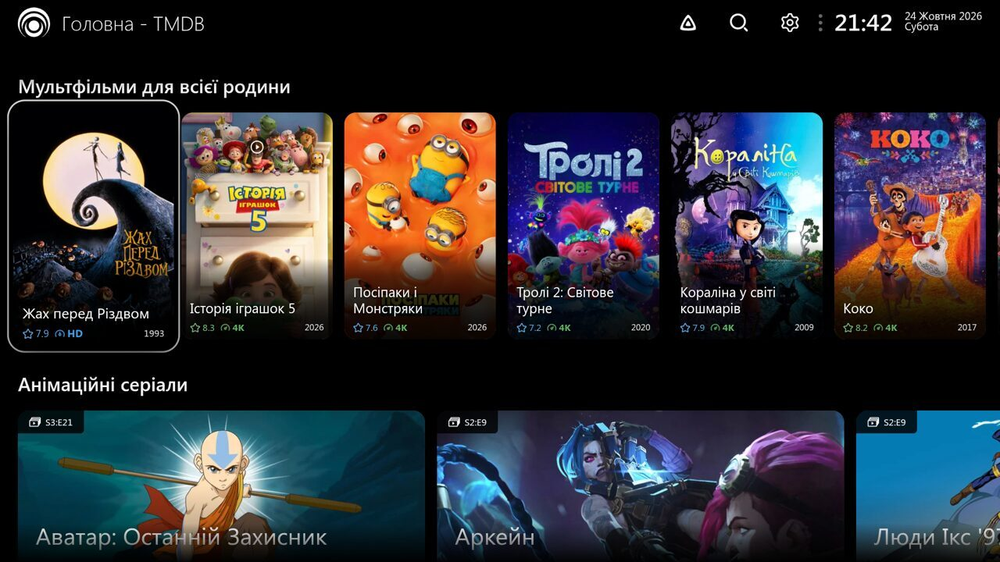

# lampac-extra

Extra modules, a helper service and Lampa plugins for [Lampac NextGen](https://github.com/lampac-nextgen/lampac).

Everything here is optional and independent: take one module or all of them. Module names start with `EX.`
and their routes with `lite/ex_`, so nothing collides with the modules that ship with Lampac.

## Contents

- [What is inside](#inside)
- [Compatibility](#compat)
- [Installation](#install)
- [Configuration](#config)
- [Exact anime matching: `animap`](#animap)
- [Remote control and diagnostics: `tvctl`](#tvctl)
- [AI-curated main screen](#rows)
- [Glint extensions](#glint)
- [Updating](#updating)
- [Support](#support)
- [License](#license)

## <a id="inside"></a>What is inside

| Part | Kind | What it does |
|---|---|---|
| `EX.AnimeON` | online source | AnimeON. Picks the exact title by MAL id when [`animap`](#animap) is configured; every episode is resolved to an HLS stream when it is chosen |
| `EX.Mikai` | online source | Mikai. Picks the exact title by its native (romaji) name when [`animap`](#animap) is configured |
| `EX.MoonAnime` | online source | MoonAnime through the account API (a subscription and a token are required); direct HLS / webm links, no browser needed |
| `EX.UFDub` | online source | UFDub (Ukrainian dubs). Opens a title only on an exact name match, offers the site's separate pages as seasons, plays direct mp4 |
| `EX.TvCtl` | service module | Server side of [`tvctl`](#tvctl): a command queue per device and a report log |
| `EX.Mcp` | service module | Serves the feed of [AI-curated rows](#rows) to Lampa from the Lampac address |
| `animap/` | helper service | TMDB card → MAL entries, with titles. Python 3 standard library only |
| `plugin/tvctl.js` | Lampa plugin | Client side of [`tvctl`](#tvctl) |
| `plugin/lampac-mcp.js` | Lampa plugin | Builds the Lampa main screen from [AI-curated rows](#rows) |
| `tools/tvctl` | command-line tool | Sends commands to a TV and reads its reports |

Why the anime modules exist: the built-in AnimeON and Mikai search by title and often show unrelated works
next to the right one. With `animap` the `EX.*` versions show only the seasons that belong to the opened card,
and stay grey in the source list when the site does not have that title at all.

## <a id="compat"></a>Compatibility

- Lampac NextGen. Tested with version 1.84.2.
- [lampac-ukraine](https://github.com/lampame/lampac-ukraine) can be installed side by side: the namespaces
  (`EX.*` / `LME.*`), routes (`lite/ex_*` / `lite/lme_*`) and `init.conf` sections are different.
  Do not enable `LME.AnimeON` / `LME.Mikai` together with `EX.AnimeON` / `EX.Mikai`, or the source list
  will show AnimeON and Mikai twice.
- The Lampa plugins are written in ES5 and run on old TV engines (Samsung Tizen 4, Android TV WebView).

## <a id="install"></a>Installation

Whichever way you choose, **restart Lampac twice** afterwards: on the first start it downloads the modules,
on the second it compiles them. The log then has lines such as `loaded module: EX.AnimeON`.

### Through `repository.yaml` (recommended)

Create or extend `module/repository.yaml` in the Lampac directory and list the modules you want:

```yaml
- repository: https://github.com/TrueNihilisme/lampac-extra
  branch: main          # optional, main by default
  modules:
    - EX.AnimeON
    - EX.Mikai
    - EX.MoonAnime      # needs a token, see Configuration
    - EX.UFDub
    - EX.TvCtl          # remote control
    - EX.Mcp            # AI-curated main screen
```

Then switch off the built-in twins in `init.conf` (see [Configuration](#config)).

### With one command

Run it on the machine that holds the Lampac files. With Docker that is the host, in the directory mounted
into the container:

```bash
curl -fsSL https://raw.githubusercontent.com/TrueNihilisme/lampac-extra/main/install.sh | sh -s -- /path/to/lampac
```

The script adds this repository to `module/repository.yaml` with `EX.AnimeON` and `EX.Mikai`, and switches
off the built-in AnimeON and Mikai in `init.conf`. Other modules are added to `repository.yaml` by hand.

| Option | Effect |
|---|---|
| `--moonanime-token TOKEN` | also installs `EX.MoonAnime`, stores the token and switches off the built-in MoonAnime |
| `--animap http://host:port` | turns on exact matching through [`animap`](#animap) for `EX.AnimeON` and `EX.Mikai` |
| `--restart CONTAINER` | restarts the Lampac Docker container twice and prints the loaded `EX.*` modules |
| `--help` | prints the usage |

Before changing anything the script saves `init.conf.before-lampac-extra` and
`repository.yaml.before-lampac-extra`. It needs `python3`, and `init.conf` must be plain JSON: if the file
has comments, the script stops without changes and the settings have to be added by hand.
Its messages are in Ukrainian.

### By hand

```bash
git clone https://github.com/TrueNihilisme/lampac-extra.git
```

Copy the module directories you need into the `module` directory of Lampac, or mount them into the container:

```bash
-v /path/to/lampac-extra/EX.AnimeON:/lampac/module/EX.AnimeON
```

## <a id="config"></a>Configuration

All settings live in `init.conf`.

Switch off the built-in modules that an `EX.*` module replaces, otherwise the source appears twice:

```json
"AnimeON":   { "enable": false, "enabled": false },
"Mikai":     { "enable": false, "enabled": false },
"MoonAnime": { "enable": false, "enabled": false }
```

Settings of the modules. Every field is optional except `token` for MoonAnime:

```json
"EX.AnimeON": {
  "animap": "http://host:8100",
  "displayname": "[UA] AnimeON"
},
"EX.Mikai": {
  "animap": "http://host:8100",
  "displayname": "[UA] Mikai"
},
"EX.MoonAnime": {
  "token": "YOUR_TOKEN",
  "displayname": "MoonAnime"
},
"EX.UFDub": {
  "displayname": "[UA] UFDub"
},
"EX.Mcp": {
  "collectionUrl": "http://host:8787/api/collection"
}
```

| Field | Module | Meaning |
|---|---|---|
| `animap` | `EX.AnimeON`, `EX.Mikai` | address of the [`animap`](#animap) service; empty means plain search by title |
| `token` | `EX.MoonAnime` | account token, see below |
| `collectionUrl` | `EX.Mcp` | address of the rows feed, see [AI-curated main screen](#rows) |

The standard fields of Lampac online modules (`displayname`, `displayindex`, `host`, `useproxy`, `proxy`
and so on) work as usual. `EX.TvCtl` has no settings.

### MoonAnime token

```bash
curl -s https://api.moonanime.vip/api/auth/login/ \
  -H 'Content-Type: application/json' \
  -d '{"username":"LOGIN","password":"PASSWORD"}'
```

The answer contains `"token": "…"` (40 characters). Put it into `EX.MoonAnime.token`.

## <a id="animap"></a>Exact anime matching: `animap`

An optional service. Without it `EX.AnimeON` and `EX.Mikai` search by title like any other source.
With it they know which MAL entries make up the opened TMDB card:

- only the seasons of that card are shown, in order;
- if the site does not have the title, the source reports "nothing found" and stays grey in the list,
  instead of offering a different work with a similar name.

```
 Lampa (TV)               Lampac                          animap                    external data
 ──────────               ──────                          ──────                    ─────────────
 an anime is opened ───▶ EX.AnimeON / EX.Mikai
 (TMDB card 209867)        │  GET /animap?tmdb=209867 ──▶ looks the card up     ◀── Fribb/anime-lists
                           │                              TMDB → MAL (daily)        (TMDB ↔ MAL, seasons,
                           │                              │                          episode offsets)
                           │                              └─ titles by MAL id   ◀── Hikka API
                           │  ◀── [{mal_id, title_ua, title_ja}, …]                 (cached)
                           │
                           ├─ searches the site by the title of the series itself
                           └─ keeps only the entries with these MAL ids ──▶ Lampa: the seasons of this card
```

### Running it

One Python file without dependencies, in [`animap/`](animap/):

```bash
python3 animap/animap.py                      # listens on :8100

cd animap && docker compose up -d --build     # or in Docker
```

Check: `curl "http://localhost:8100/animap?tmdb=209867&type=tv"` returns the three seasons of "Frieren".
The first request after a start waits for the Fribb list to download (about 7 MB).

| Variable | Default | Meaning |
|---|---|---|
| `PORT` | `8100` | port to listen on |
| `REFRESH_HOURS` | `24` | how often the TMDB ↔ MAL list is downloaded again |
| `FRIBB_URL` | Fribb `anime-list-full.json` on GitHub | source of the TMDB ↔ MAL list |
| `HIKKA_URL` | `https://api.hikka.io` | source of the titles |

Then point the modules at it: `"EX.AnimeON": { "animap": "http://host:8100" }`, and the same for `EX.Mikai`.

### API

```
GET /animap?tmdb=209867&type=tv        type: tv (default) | movie
GET /health
```

The answer, shortened to two of the three entries:

```json
{ "ok": true, "tmdb": 209867, "type": "tv", "entries": [
  { "mal_id": 52991, "tmdb_season": 1, "episode_offset": 0,  "title_ua": "<Ukrainian title>", "title_ja": "Sousou no Frieren" },
  { "mal_id": 59978, "tmdb_season": 1, "episode_offset": 28, "title_ua": "<Ukrainian title>", "title_ja": "Sousou no Frieren 2nd Season" }
] }
```

Each entry also carries `type`, `anilist_id`, `imdb_id`, `hikka_slug`, `title_en`, `year` and `episodes`.
The modules use `mal_id` and `title_ua` (AnimeON) or `title_ja` (Mikai). Specials, which TMDB keeps in
season 0, are listed too; the modules take the search title from a real season.

Data: [Fribb/anime-lists](https://github.com/Fribb/anime-lists), [Hikka API](https://api.hikka.io/docs).

## <a id="tvctl"></a>Remote control and diagnostics: `tvctl`

`tvctl` drives Lampa on a TV from a computer and shows what happens there: which request went to a source,
with which status and how long it took, what Lampa displayed, whether the player started. It answers
"why does this source not work on the TV" without walking through the menus with a remote.

It has three parts: the module `EX.TvCtl`, the Lampa plugin `plugin/tvctl.js` and the script `tools/tvctl`.

### Setup

1. Install the module `EX.TvCtl` (see [Installation](#install)) and restart Lampac twice.
2. Copy `plugin/tvctl.js` to `<Lampac>/wwwroot/custom/tvctl.js`.
3. In Lampa open Settings → Extensions → Add plugin, enter `http(s)://YOUR-LAMPAC/custom/tvctl.js` and
   restart Lampa.
4. On the computer:

```bash
export LAMPAC=http://your-lampac:9118
export LAMPAC_PASSWD=...            # Lampac root password, the file <Lampac>/passwd

./tools/tvctl devices                                          # who is connected
./tools/tvctl cmd '{"cmd":"open","id":209867,"type":"tv"}'     # open a TMDB card
./tools/tvctl cmd '{"cmd":"online"}'                           # open "Online"
./tools/tvctl cmd '{"cmd":"items"}'                            # what is on the screen, numbered
./tools/tvctl cmd '{"cmd":"click","index":5}'                  # press item 5
./tools/tvctl log 20                                           # the last 20 reports
```

`tvctl cmd '<json>' [DEVICE]` sends the command to the named device, to `$TVCTL_DEV`, or to the first
device that is connected. `tvctl log [N]` prints the last N reports (30 by default). Times are shown in the
time zone of the computer.

The device name is the Android model from the User-Agent (for example `MIBOX4`), `TIZEN` on Samsung, and a
random id saved in Lampa otherwise. To let only some devices answer, set a list before the plugin loads:

```js
window.tvctl_devices = ['MIBOX4', 'TIZEN'];
```

### Commands

| Command | Parameters | Effect |
|---|---|---|
| `state` | | the current screen, its title, the focused item and the active layer (`controller`) |
| `items` | | numbered list of what can be pressed in the active layer |
| `click` | `index` | presses item `index` from the list |
| `key` | `keys` | presses keys in order: `up`, `down`, `left`, `right`, `enter`, `back` (the Back button), `backward` (one screen back) |
| `home` | | opens the main screen |
| `settings` | | opens Settings |
| `open` | `id`, `type` (`tv` or `movie`), `source` (optional, `tmdb` by default) | opens a card |
| `online` | `balanser` (optional) | opens "Online" for the current card, optionally with a source |
| `play` | `url`, `title` (optional) | plays any stream address in the Lampa player |
| `media` | | player position and length in seconds, pause state, picture size; length is 0 for live streams on Tizen |
| `seek` | `t` | jumps to second `t` |
| `pause`, `resume` | | pause and continue |
| `reload` | | reloads Lampa |
| `goto` | `url` | opens a page of the same Lampac in place of Lampa, for example `/custom/<page>/`; going back in history returns to Lampa |
| `caps` | | what the browser engine supports (`backdrop-filter`, `grid` and so on) |
| `plugins` | | plugins stored on the device and those that failed to load at this start |
| `plugins_prune` | | removes stored plugins that have no address; Lampa reports them as "not loaded" at every start |

`items` and `click` work in the layer that has the focus: settings, a selection list, a dialog, the menu,
the header or the screen. `state` names that layer.

### Reports

`hello`, `result`, `req` (requests to sources, including the native ones on Android), `xhr`, `noty`
(Lampa messages), `player_start`, `player_destroy`, `activity`, `error`.

### Security

The TV polls `/tvctl/poll` and posts to `/tvctl/report` without a password. Sending commands and reading
the log (`/tvctl/cmd`, `/tvctl/log`, `/tvctl/devices`) require the Lampac root password.
The log is kept in memory only. It can contain full stream addresses (`player_start`), so treat its
output as private.

## <a id="rows"></a>AI-curated main screen



The Lampa main screen is built from rows that an AI maintains: poster rows and wide 16:9 rows alternate —
movies, series, cartoons, anime. The rows and their contents are managed through the
[lampac-mcp](https://github.com/TrueNihilisme/lampac-mcp) server. Lampa receives only TMDB ids; posters,
backdrops and descriptions come from its own TMDB source and are cached on the device for a day.
Rows of Lampa itself and of other plugins, such as "Continue watching", stay below.
Without rows, or when the server is unreachable, the usual TMDB main screen is shown.

1. Run [lampac-mcp](https://github.com/TrueNihilisme/lampac-mcp).
2. Install the module `EX.Mcp` and set the feed address in `init.conf`:
   `"EX.Mcp": { "collectionUrl": "http://host:8787/api/collection" }`.
   Lampa reads the feed through Lampac (`/mcp/collection`), from the same address as everything else,
   so there are no CORS or mixed-content problems.
3. Copy `plugin/lampac-mcp.js` to `<Lampac>/wwwroot/custom/` and add it in Lampa as a plugin
   (Settings → Extensions → Add plugin).

The plugin needs Lampa 3 or newer. If it loads after the main screen has already been built, which happens
on Android TV, it refreshes the screen once.

## <a id="glint"></a>Glint extensions

Extensions for [Glint](https://github.com/TrueNihilisme/glint), a separate TV front-end for Samsung Tizen 4,
live in its repository: [`extensions/`](https://github.com/TrueNihilisme/glint/tree/main/extensions).

## <a id="updating"></a>Updating

Lampac checks the repositories from `repository.yaml` at every start and downloads new module versions in
the background. A downloaded version is compiled at the next start, so an update also takes two restarts.

The Lampa plugins and `animap` are plain files: replace them with the new versions.

## <a id="support"></a>Support

If this project is useful to you, you can support its development with a crypto donation:

| Network | Address |
|---|---|
| Bitcoin (BTC) | `bc1q0sw0w9mqtghrxfyyqw834sjs7t7rr7futulgv4` |
| Ethereum (ETH) | `0xAb3a04a4b52547a7f8B00abb0088D3d9d11CA461` |
| Solana (SOL) | `2QBoKrUaiAcAKxNJ7o9oe9Q16ptjLQohR8KyPX2tpJhZ` |

Send each coin only on the network named in its row: a transfer made on another network cannot be recovered.

## <a id="license"></a>License

[GNU AGPL-3.0](LICENSE).

`EX.AnimeON`, `EX.Mikai` and `EX.MoonAnime` are modified versions of the modules of the same name from
[Lampac NextGen](https://github.com/lampac-nextgen/lampac) (AGPL-3.0) and inherit its terms.
They were first modified on 2026-10-22; the commit history lists every change.

`EX.UFDub`, `EX.TvCtl`, `EX.Mcp`, `animap`, `tvctl.js`, `lampac-mcp.js` and `tvctl` are original to this
repository.
